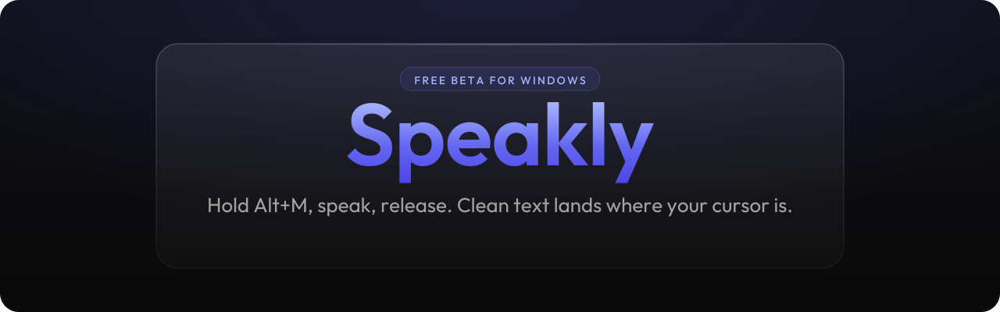

  

  Voice dictation for Windows that stays out of your way.

<h2 align="center">
  <a href="https://github.com/AR-101/myspeakly-releases/releases/latest">Download Speakly for Windows</a>
</h2>

  Windows 10 and 11, 64-bit. Free during beta.

---

## What Speakly is

Speakly turns your voice into clean, ready-to-send text in any Windows app. Hold Alt+M, speak naturally, let go, and your words are transcribed, lightly tidied up and pasted right where your cursor is. You bring your own API key, so your audio and text only go to the provider you pick.

> **Free during beta.** Speakly is free while it is in beta. You only need a free API key from an AI provider such as Groq.

## Demo

<!--
  Demo placeholder. To add the demo:
  1. Record a short clip with ScreenToGif (about 10 to 20 seconds, around 960 px wide).
  2. Save it as assets/demo.gif in this repo.
  3. Replace the placeholder line below with:
     

-->

*Demo coming soon: `assets/demo.gif` (placeholder, not recorded yet).*

## Requirements

- Windows 10 or Windows 11, 64-bit
- A microphone
- A free API key (Groq is free and takes about a minute to set up)

## Install and set up

1. **Download** the latest installer from the [Releases page](https://github.com/AR-101/myspeakly-releases/releases/latest).
2. **Run** `Speakly-Setup-x.y.z.exe` (the numbers are the version).
3. **If Windows shows "Windows protected your PC"**, click **More info**, then **Run anyway**. See the SmartScreen note below.
4. **Open Speakly** from the system tray (the small icons near the clock; you may need to click the arrow to see it).
5. **Get a free Groq key** at [console.groq.com](https://console.groq.com). Sign in, open API Keys and create a key.
6. **Paste the key** into Speakly under **Settings > AI Setup**.
7. **Dictate.** Click into any text box, hold **Alt+M**, speak, then release. The text is pasted where your cursor is.

### About the SmartScreen warning

Speakly is not code signed yet, so Windows SmartScreen does not recognise it and shows "Windows protected your PC" the first time you run the installer. This is expected for a new, unsigned app. Click **More info**, then **Run anyway**. You only need to do this once per download.

## Features

- **Hold to talk.** Hold Alt+M, speak, release. That is the whole workflow.
- **Hands-free mode.** Double-tap Alt to start dictating without holding a key, and double-tap again to stop. Good for longer thoughts.
- **Light cleanup that keeps your voice.** Filler words and obvious slips are tidied, but your wording stays yours.
- **Transforms and polish.** Turn a rough thought into a clear email, a short reply or a bullet list with a shortcut or a saved prompt.
- **Voices.** Pick a writing style, from casual to professional, and switch any time.
- **Per-app behavior.** Use a different voice or style per app, for example relaxed in chat and formal in email.
- **Snippets.** Say a short phrase and Speakly inserts a longer saved block of text, like your address or a sign-off.
- **Dictionary.** Teach Speakly names, product terms and jargon so they are spelled right every time.
- **Auto-copy to clipboard.** The final text stays on your clipboard after it is pasted, so if a paste ever misses, press Ctrl+V to get it back.
- **Multiple providers with failover.** Groq, Cerebras, Gemini, Anthropic, OpenAI or a local model through Ollama. If one provider is down, Speakly moves to the next one you have set up.

## Privacy and your keys

Speakly is built around bring your own key (BYOK).

- **Your keys stay on your PC.** API keys are stored in Windows Credential Manager, not in a plain text file.
- **Each key only goes to its own provider.** Your Groq key is sent only to Groq, your OpenAI key only to OpenAI, and so on.
- **Your audio goes only where you choose.** Recordings are sent only to the provider you selected for transcription. With local Whisper and Ollama, audio and text never leave your machine.
- **No Speakly server in the middle.** Speakly does not run its own cloud service for your dictation.

## FAQ and troubleshooting

<b>Nothing pastes after I release Alt+M</b>

- Make sure your cursor is in a text box before you start, and that you did not switch windows while speaking. If you switch windows, Speakly keeps the text on the clipboard instead of pasting it into the wrong place.
- Press **Ctrl+V**. With auto-copy on (the default), the last result is on your clipboard.
- Check **Settings > AI Setup** and confirm your API key is saved and the provider shows as available.
- Some apps that run as administrator block input from normal apps. If you dictate into an admin window, run Speakly as administrator too.
- If an app ignores pasting, try switching the output method from paste to type in Settings.

<b>Alt+M does nothing or triggers something else</b>

Another app may already use Alt+M (some editors, games and screen recorders do). Open Speakly Settings and pick a different shortcut, or change the shortcut in the other app. The hands-free shortcut (double-tap Alt) can be changed in the same place.

<b>How do I update?</b>

Speakly checks for new versions on its own and shows a notice when one is available. To update, download the latest installer from the [Releases page](https://github.com/AR-101/myspeakly-releases/releases/latest) and run it. It installs over the current version. Your API keys stay in Windows Credential Manager.

<b>Is it really free?</b>

Yes, during the beta. You pay nothing to Speakly. Groq offers a free tier. Other providers may charge you directly for what you use.

<b>Does it work offline?</b>

Yes, if you use local Whisper for transcription and Ollama for cleanup. Everything then runs on your own PC.

## Mac

Mac: coming soon.

## Feedback

Found a bug or have an idea? [Open an issue](https://github.com/AR-101/myspeakly-releases/issues).
